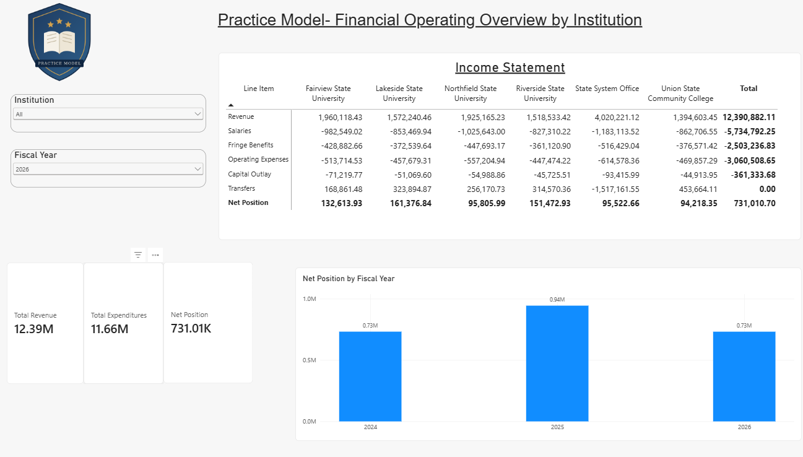
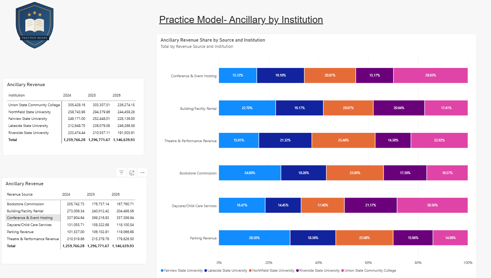
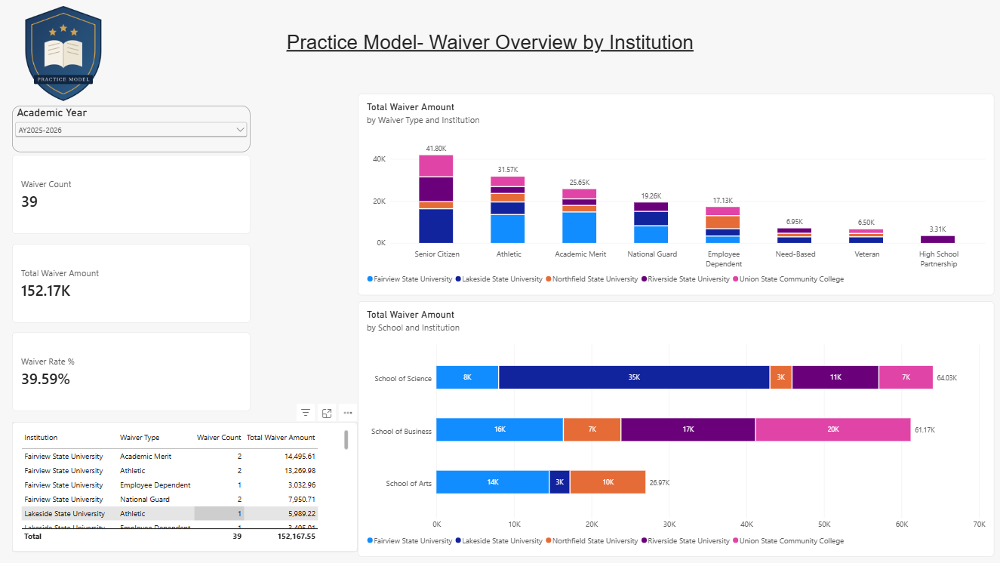
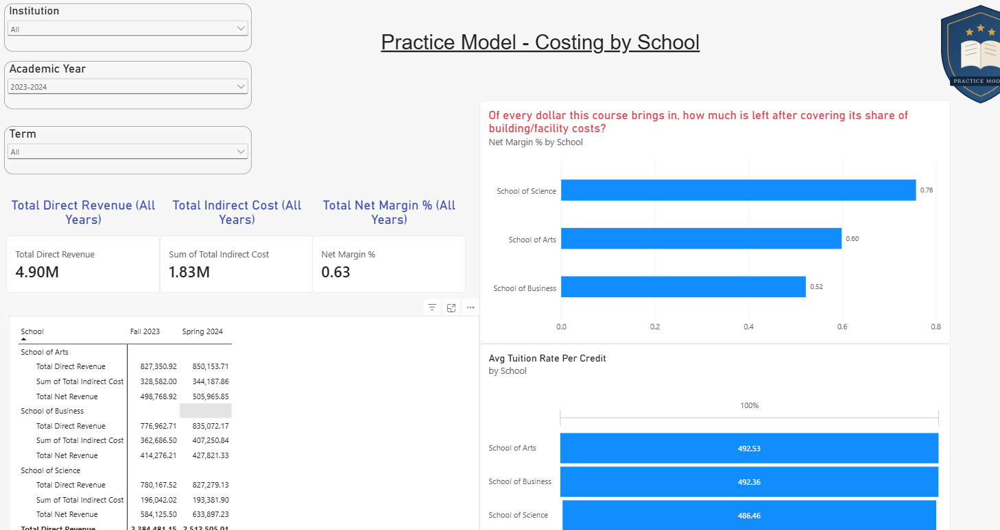
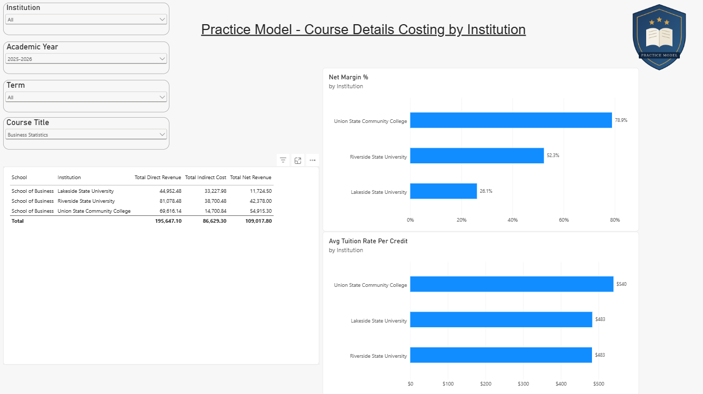
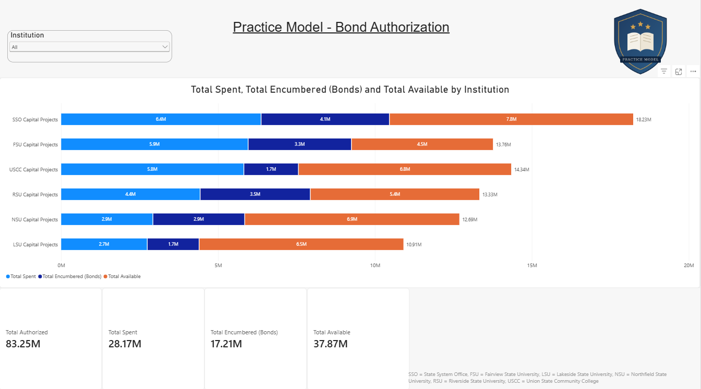
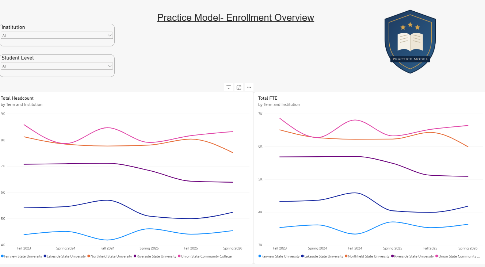

Higher Education Financial Dashboard (Power BI)
A multi-page Power BI report I designed and built from scratch on a fictional six-institution public college system. It shows how I approach multi-source data reconciliation, data modeling, DAX, and dashboard design for financial and enrollment reporting.
All data is fictional. Institution names, dollar amounts and records are randomly generated. No real student, financial or personnel data is used anywhere in this model. What is realistic is the structure: the tables, relationships and reconciliation logic mirror how a statewide ERP (PeopleSoft) and a student information system (Banner) connect in practice.

View the full report as a PDF (no Power BI needed) or download the Power BI file.
Report Pages
Page	What it shows
Financial Overview	Income statement by institution and fiscal year (revenue, salaries, fringe, operating expenses, capital outlay, transfers), with total revenue, expenditures and net position cards
Ancillary Revenue	Non-tuition revenue such as building rentals, theatre, daycare and parking
Waiver Overview	Tuition waivers by category (Statutory, Contractual, Presidential, Other) and waiver rate against total student charges
School Costing	Revenue, indirect cost and net margin rolled up by school
Course Costing	Course-level direct revenue, allocated indirect cost and net margin, with a drill-through to compare one course across institutions
Bonds	Bond authorization tracking: authorized, spent, encumbered and available
Enrollment	Headcount and FTE by institution, term, student level and residency
About	Data scope, definitions, assumptions and methodology
Data Model
Financial transactions: fiscal years 2024 to 2026 (7/1/2023 to 6/30/2026), actuals only (budget, expenditure, revenue)
Enrollment, waivers, financial aid and course costing: Fall 2023 to Spring 2026 (three academic years)
Bond authorizations: 2023 to 2026
Related across institution, fund, department, account, academic year and term, so every page responds to the same slicers
Key Measures and Logic
```DAX
Total Direct Revenue = SUM(course_costing[Direct Revenue])
```
Measure	Logic
Net Position	Revenue minus expenditures, on actual closed-period totals
Total Available (Bonds)	Authorized amount minus spent minus encumbered
Net Margin % (weighted)	Net revenue divided by direct revenue, calculated from summed totals so higher-revenue periods carry more weight
Avg Tuition Rate Per Credit	Simple average across the terms in scope
Waiver Rate %	Total waiver amount divided by total student charges (tuition, fees, housing, meal plans)
Indirect Cost Allocation	Cost-per-credit-hour: each building's annual cost (operating plus depreciation) divided by credit hours taught there, applied to each course by its credit hours
Methodology Notes
Course costing uses a cost-per-credit-hour allocation, a recognized activity-based costing approach in higher education finance. A 50/50 split between operating and capital/depreciation cost is a simplifying assumption for this model.
Bond tracking shows a complete Authorized / Spent / Encumbered / Available reconciliation as if all of that data lived in one system. In practice, encumbrances are often tracked in a different system than authorizations and spending, which is exactly the kind of gap this model is designed to make visible.
FTE uses a simplified ratio (85% undergraduate, 60% graduate) rather than registrar credit-hour calculations.
Course catalog is illustrative (three sample courses per school per term), so per-course costs would change with a full catalog.
Screenshots
Ancillary Revenue

Waiver Overview

School Costing

Course Costing

Bonds

Enrollment

Tools
Power BI Desktop, DAX, Power Query, data modeling, Excel
About Me
I'm Michelle Leonard, a finance and data professional with 20+ years of experience turning messy multi-system data into reporting that leaders trust and use. LinkedIn
